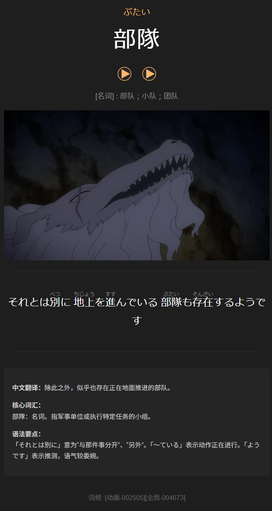
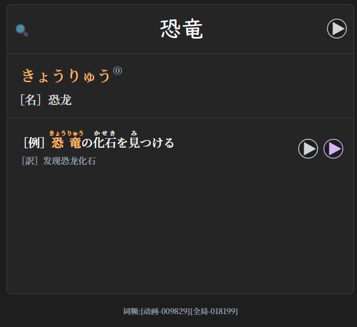

# anki-workspace

> 状态：active ｜ 最后核实：2026-10-29

一个「日语学习 × Anki」自动化工作区：把「看动画 → 做卡 → 复习 → 查漏」串成可重跑的脚本，
而不是每次手工整理。当前收藏 **39,820 张卡 / 26 个牌组**，所有入口都在 `code/cli.py`。

本文件是**项目说明书**（给人读）：是什么、怎么跑、怎么测、目录长什么样。
**Agent 的行为契约在 [AGENTS.md](AGENTS.md)**——角色与边界、硬性禁令、验证命令、失败与求助条件；
两者冲突时以 AGENTS.md 为准（见 §10）。设计细节见 [docs/architecture.md](docs/architecture.md) 及各专项手册。

---

## 1. 它做什么

**为「提升日语动画听力」而建**——目标是甩开字幕听懂对白，而不是应付考试。
打底是两套成熟考级牌组（`1-高频日语单词 6000`、`2-考级词汇` N5–N1）覆盖日常日语的骨架；
动画对白还有考级词表查不到的词汇面（拟声拟态、口语缩略、题材词、俚语），
于是第三个牌组 `0-素材生词`：从看过的字幕里挖「**考级牌组里没有、但 Jiten 动画词频里常见**」的词收进去——
**这是本工作区最主要的服务功能**。

| 主线 | 输入 | 产出 |
|---|---|---|
| 每集流水线 | 一集字幕（`.ass/.srt`） | 例句卡 → 清理 → 讲解 + 振假名 → 素材生词 → 配音 |
| 每日链路 | 当天 tag `今天学习生词` 选出的词（来自字幕；选词机制见下文 §1 末） | 日语讲义（`output/daily/lesson_latest.md`）、复习后弱项报告 |
| 词汇分析 | 字幕语料 + 现有卡组 | 覆盖率、新词表、挖掘窗口建议、跨作品通用性判定 |
| 收集类 | 一段文字 / 一集字幕 | 专有名词卡（`3-专有词汇`，不进队列）、`复习::<名称>` 标签 |

### 三个牌组，三种卡

三个牌组问的不是同一件事：素材生词练**听辨**（词音频先响，认词形与意思），考级词汇练**看字回想**
（只看词形，回想读音和释义），`2-例句` 练**整句**（画面 + 原声 → 句子和讲解）。下面三张都是翻面后的
答案面：

<table>
  <tr>
    <td align="center" width="33%"></td>
    <td align="center" width="33%"></td>
    <td align="center" width="33%"></td>
  </tr>
  <tr>
    <td align="center" valign="top"><b>听辨卡</b><br><code>0-素材生词</code></td>
    <td align="center" valign="top"><b>看字回想卡</b><br><code>2-考级词汇</code></td>
    <td align="center" valign="top"><b>例句卡</b><br><code>2-例句</code></td>
  </tr>
</table>

- **听辨卡（`0-素材生词`）**：正面只有词形和词性，词音频自动播放；翻面给读音 `ぶたい`、
  词性释义、挖出这个词的那句台词（带振假名）、动画画面和讲解。底部 `[动画-002505][全局-004673]`
  是 Jiten 词频——挖词时先按这个排名决定收不收、先不先学。
- **看字回想卡（`2-考级词汇`）**：正面给词形「恐竜」和原句音频，读音与释义要自己先想；翻面才给
  `きょうりゅう`、音调 ①、词性「名」、中文释义「恐龙」，以及一句带译文的例句。底部同样是 Jiten 词频。
- **例句卡（`2-例句`）**：正片画面 + 原声提问，翻面是带振假名的整句、中文翻译、核心词汇与语法要点。
  下一节展开看一张。

> **听辨卡不止一个牌组**：`0-素材生词` 和 `1-高频日语单词 6000`（core6000）共用同一个笔记类型
> `Japanese Vocabulary` 与同一个模板（`Word → Meaning`），卡面完全一样——区别只在词的来源：
> 一个从看过的字幕里挖，一个来自 Core 6000 词表。

### 展开看一张例句卡

<p align="center"></p>

这是一张 `2-例句` 卡：上方是台词对应的动画画面（asbplayer 插件导入），下方是流水线生成的内容——
原句的振假名（`Sentence HTML`）与 `AINote` 四节（中文翻译 / 核心词汇 / 语法要点 / 动词变形解析；
四节结构与生成口径见 [pipeline-guide](docs/pipeline-guide.md)）。
**画面与字幕是素材，讲解文字才是工作区生成的**；流水线做的事就是把一集字幕变成一批这样的卡，
再进入生词挖掘、复习和弱项分析。

### 每天学哪些词：`今天学习生词`（核心日常）

每日链路的入口。给一集字幕或整部作品的目录，脚本会扫**整部作品**（同目录所有集），
统计每个词的「出现次数 / 跨了几集」，再和 `JitenAnimeRank`（全球动画词频）合成一个分，
取前 30 个**已有卡但还没学**的词，打上 `今天学习生词`。每次运行先把全库旧标签摘掉，
所以这个标签永远只代表「今天这一批」。每日讲义只认这个 tag
（[docs/today_new-使用说明.md](docs/today_new-使用说明.md)）。

```
S = ln(1+次数) + 0.30·ln(1+集数) + 0.30·ln(30000/JAR)
```

**次数翻一倍 ≈ JAR 排名前移 10 倍**（`2^(1/0.30)`）。`--mu` 管跨集加成、`--lam` 管词频权重。
JAR 只作次级加分：它排名靠前多是 `おっ`/`くっ`/`やっぱ` 这类语气词，真正的分量在「本作里出现多少」。

选出来的词还要过两道闸，否则今天学的就是错的义项：

| 闸 | 判据 | 挡掉的例子 |
|---|---|---|
| **读音**（机械，免费） | 卡片读音 vs 字幕里该词的词典形读音 | `頭` 名下 `あたま`（头）和 `かしら`（首领）两张卡，只标对得上的那张 |
| **义项**（本地模型） | 字幕句里的义项 vs 卡片释义 | `空`（卡片「空的」/ 字幕「空の下」＝天空）、`吐く`（「呕吐」/ 吸烟语境＝呼气） |

助词、感动词、角色语尾（`かしら`、`〜にゃ`）直接影响对白语气，**单独给 2 个名额**（`--particles`），
不跟内容词抢；格助词/系助词/接续助词（が・で・を・は）作为语法胶水排除。

```powershell
& $PY code\cli.py today-new "subtitles\Yani Neko"              # 演练，只打印名单
& $PY code\cli.py today-new "subtitles\Yani Neko" --commit     # 真写标签
& $PY code\cli.py today-new --revert --commit                  # 撤销上一次
```

产物：`output/daily/today_new_words.md`（名单）、`data/daily_new/<日期>/picked.json`
（分数拆解 / 义项判定 / noteId）、`data/daily_new/state.json`（回退记录）。
**只写 `tags`**，不碰 `due/ivl/factor/type/queue`；要把这 N 个词挪到新卡队首是另一支
（`jp-anki-activate`）。设计与取舍见
[ADR 2026-10-29](docs/decisions/2026-10-29-今日选词打分与义项核验.md)。

### 拿任意文本/字幕量一量：覆盖率与生词分析

流水线之外还有一条**随时可跑的体检链**：输入任意 `.srt/.ass/.vtt`、`.txt`、一段话或标准输入，
就能回答「这段文字我认识多少、还差哪些词」。词汇状态来自 AnkiConnect 现场快照
（`collect_vocab.py` 抽成 `data/vocab_cover/vocab_state.json`），换素材不用动卡组。

| 想知道什么 | 命令 | 产物 |
|---|---|---|
| 这段文字我懂多少 | `cli.py vocab cover <文件>`（也吃 `--text` / `--stdin`） | 三个分母的覆盖率、句子级可懂度、新词预览 |
| 新词具体是哪些 | `cli.py vocab newwords <文件或目录> --mine-only` | 读音 / 词性 / 首例句 / Jiten 档位，可导 TSV、Markdown、JSON |
| 出一份学习用生词报告 | `cli.py vocab report <文件或目录>` | 固定章节的 Markdown + JSON（规模 / 分档 / 题材词 / 值得挖 / 不用记） |
| 每季只挖前 N 集值不值 | `cli.py vocab mine_window --k 3` | 覆盖占比、效率、边际效率、窗口外高价值词 |
| 全部字幕的整体水位 | `python code\analysis\vocab_cover\report_build.py` | 自动刷新快照 + `metrics.json` + 5 张图 + Markdown |
| 卡组贴不贴动漫词频榜 | `jiten_fit.py` / `rank_buckets.py`（`vocab_cover` 下） | 榜→卡组覆盖、卡组→榜名次、每千词已学占比 |
| 学哪些、还差多少、每天放几张 | `study_plan.py` / `mature_eta.py` / `study_time_budget.py`（`vocab_cover` 下） | 学习顺序收益、全成熟 ETA、新卡时间预算 |

**口径**：三个分母差别很大，报告里必须写清——**含语法词**（全部词元，助词/助动词按「你懂」计）、
**词汇词**（去掉语法词与符号）、**需背实词**（再去掉专有名词、感动词、数词，这才是词汇量的分母）。
「已学」= 刷过至少 1 次，「已成熟」= 复习卡且间隔 ≥ 21 天；分词走 SudachiPy，Jiten 名次按
「出现在多少部作品里」排，不按单部重复次数。新词也分两档：卡组外的 `oov` 与有卡没学的 `untackled`。

产物落在 `docs/reports/`（本地保留、未入库），图表在 `output/vocab_cover/`——
`字幕覆盖率与词汇量报告.md`、`挖掘窗口分析.md`、`Jiten动漫词库贴合度.md`、`词汇三卡组配比.md`
都是这条链跑出来的。报告数字随快照漂移，引用时以文件头的生成时间为准。

回到全局，三条贯穿全项目的原则（完整口径见 AGENTS.md §3）：**流水线不碰学习调度**（新卡顺序由 `JitenAnimeRank`
与 `cards.due` 决定）、**机械判断归代码、语义判断归模型**（结构 / 逐字一致 / 回读由 `code/common/`
检查器判）、**生成默认直连本地模型**（local-llm 技能）。

## 2. 快速开始

```powershell
$WS = "<工作区根>"
$PY = "python"
```

> `<工作区根>` 与 `python` 是占位符：前者换成这个目录的绝对路径，后者换成任意 Python 3 解释器。
> 文档与代码里不写本机的用户名、盘符和解释器路径。

**前置**：Anki 打开（AnkiConnect `127.0.0.1:8765`）。唯一例外是备份——那时必须**完全退出** Anki。
第一次进工作区先跑体检：`& $PY "$WS\code\cli.py" doctor`。

| 想做什么 | 命令 |
|---|---|
| 开工体检（只读门禁） | `cli.py doctor` ／ 离线 `doctor --skip-anki` ／ 查某集 `doctor --tag "动画::…"` |
| 每集主线一条命令（阶段 2–5） | `cli.py episode --tag "动画::<作品>::<季>::第NN集" --input-tag 待标记 [--commit]` |
| 每日讲义 | `cli.py daily stats` → `daily plan` → `daily check` → `daily gen` |
| 复习后弱项 | `cli.py weak today --days 3 --plain`（另有 `revlog` / `pace` / `build-list`） |
| 点名 core6000 词补第二条例句 | `cli.py core6000 gen --words "徹夜,適当"` → `tts` → `apply`（先演练再看 `--commit`） |
| 给一个词找真实例句（jisho，不造句） | `cli.py jisho --word "徹夜" --reading "てつや"`（只读） |
| 加强某张卡的讲解与语感 | `cli.py ainote enrich --word 分際 --commit` |
| ImmersionKit 按词表抓例句卡 | `cli.py immersion fetch` → `gen` → `write --to both --commit` → `verify` |
| 词汇覆盖率 / 新词表 / 挖掘窗口 | `cli.py vocab cover` ／ `newwords` ／ `report` ／ `mine_window --k 3` |
| 全局 Jiten 词频序重排 | `cli.py vocab reorder-jiten [--commit]`（默认演练） |
| 收摊：清一次性文件 | `cli.py temp list` → `temp clean` |
| 备份到 G: 盘 | `cli.py backup --dest <备份盘>:\anki-backup-<日期>`（先退出 Anki） |

`cli.py list` 与 `cli.py <组> --help` 是**权威用法来源**——比任何文档都新。
未纳入统一入口的脚本（如 `vocab_cover/` 里另外 20 个数据链脚本）直接调用，
见 [docs/architecture.md §4-5](docs/architecture.md)。

## 3. 开工体检 `doctor`（只读，几秒）

一次跑完九项：AnkiConnect、Anki 访问点自审、`textio` 编码自审、废弃符号、快照卫生、
文档状态行、每集 preflight、环境与依赖、工作区卫生。
**退出码**：`0` 全绿；`2` 只有提示；`1` 有阻塞项——**先修再动手**。
各项的来源与判定口径见 [architecture §3](docs/architecture.md)。

## 4. 目录结构

```
anki-workspace/
├─ README.md                本文件：项目说明书
├─ AGENTS.md                ★ Agent 行为契约（边界 / 禁令 / 验证 / 求助）
├─ code/                    可复用代码：cli.py（统一入口，薄分发器）
│                            + common / execution / tools / analysis / tests / oneshot
│                            （代码地图与脚本清单见 AGENTS.md §5）
├─ docs/                    手册与档案（architecture / pipeline-guide / deprecated / decisions / images / reports）
├─ data/                    输入与中间产物（snapshots、pipeline、vocab、pylibs、freq、plans、evidence、dict）
├─ output/                  生成物（daily 讲义、audio、vocab_cover）
├─ subtitles/               原始字幕素材（vocab_cover 的输入）
├─ core6000-analysis/       独立子项目：core6000 听辨卡分析（自带脚本与 docx 报告）
├─ temp/                    ★ 唯一的一次性文件区（临时脚本 / dump / 日志）
├─ archive/experiments/     一次性的实验与旧证据（见其 README.md）
└─ .dsh/skills/             技能（一技能一任务；任务 → 技能路由表在 AGENTS.md §4）
```

## 5. 一次字幕流水线

`cli.py episode` 把下面几步串起来（`--commit` 才真写；不加则全链演练）：

| 阶段 | 谁跑 | 产物 |
|---|---|---|
| 0–1 预处理 + 清理 | `pipeline.py prepare` → `triage` | 判弃无学习内容的卡；可选先跑 `filter_subtitle.py` 筛字幕 |
| 2 生成 | `pipeline.py gen` | `data/pipeline/gen/{input,output,manifest}.json`；`AINote` + `Sentence HTML` |
| 4 素材生词 | `mine.py` | `data/vocab/{mine_candidates.json,gen_mine/*}` → `0-素材生词` |
| 5 配音 | `mine_audio.py` | `output/audio/*.mp3` → 上传 Anki 媒体库 |
| 改标签 | `episode.py retag` | 把导入时的 `待标记` 换成正式集标签 |

运行记录落在 `data/pipeline/runs/<时间戳>-<集>.json`。每步的判据、批次建议、失败重试
见 [docs/pipeline-guide.md](docs/pipeline-guide.md)（60 KB，按节查，不必通读）。

## 6. 数据流

```
Anki 收藏 ──复制──> data/snapshots/…                    （分析用只读快照）

episode.py ──> pipeline.py（阶段 0-2）──> mine.py（阶段 4）──> mine_audio.py（阶段 5）
                                    └──> data/pipeline/gen/     data/vocab/      output/audio/

proper.py        ──> data/vocab/proper/<作品>_<集>/（专名卡，不进队列）
today_new.py     ──> output/daily/{cards_*.json, lessons/*, lesson_*.md}（直连本地模型）
today_new_words  ──> data/daily_new/ + output/daily/today_new_words.md（每天 N 个「今天学习生词」）
core6000_example ──> 5 个字段 + output/audio/core6000/*.mp3
ainote_enrich    ──> 只写 AINote（旧值备份 data/ainote/backup_*.json）
analysis/        ──> docs/reports/*.md、data/vocab_cover/*、output/vocab_cover/*.png
```

## 7. 测试

12 个回归测试都是**独立脚本、纯离线**（不连网、不碰 Anki 写接口），秒级返回；
2026-10-28 复核全部通过。跑法：

```powershell
& $PY "$WS\code\tests\test_llm_out.py"     # 换一个文件名就是另一组
```

| 测试 | 挡什么 |
|---|---|
| `test_llm_out.py` | 本地模型产出吸收层：畸形 JSON、字段类型错、整组超预算、漏卡重问 |
| `test_mine_patch.py` | 阶段四 `merge-fix` 的前缀回退（2026-10-12 事故） |
| `test_immersionkit.py` | ImmersionKit 抓句链路纯函数：振假名对齐、标签、字段一致性 |
| `test_jisho_example.py` | Jisho 例句解析、token 边界匹配（体中/ヤニ）、注音对不齐兜底 |
| `test_core6000_jisho.py` | core6000 补例句的「新句来自 Jisho」：书写骨架偏好、四道候选闸门、模型改写被覆盖 |
| `test_jiten_rank.py` | `JitenAnimeRank`/`JitenGlobalRank` 查表、词字段推导与 6 位补零（文本序 = 数值序） |
| `test_proper_extract.py` / `test_proper_patch.py` | 专名抽取的确定性部分、专名卡字段规则 |
| `test_subtitle_tag.py` | 字幕打标的纯逻辑：跳过已复习词、只写 tags |
| `test_today_new_words.py` | 每日生词挑选：Jiten 升序、无排名垫底、上限 N、标签差集 |
| `test_lesson_render.py` | 每日讲义口径：词形/读音、词性校正、同词合并、接续脏数据、计数自洽、讲解机械错 |
| `test_lesson_dict.py` | 每日讲义的 JMdict 纠错：读音不在词典读音表、词性冲突、他动/自动、词典不可用降级、渲染校正 |

跑完会在 `temp/test_*` 留下产物，属于正常（`temp/` 就是一次性文件区）。

## 8. 维护约定

工程约定（代码四区、路径走 `paths`、文本 I/O 走 `textio`、碰 Anki 走 `anki_api`、
一次性文件只进 `temp/`、改行为前先体检）在 [AGENTS.md](AGENTS.md) §8 写全——
**单一来源，本文件不再复制**；人和代理都照那里执行，冲突时以 AGENTS.md 为准。

## 9. 备份与恢复

```powershell
& $PY "$WS\code\cli.py" backup --dest <备份盘>:\anki-backup-<日期>
```

硬规则：备份收藏库前**完全退出 Anki**；新备份校验通过后才删旧的。校验与恢复流程见
[docs/backup-sop.md](docs/backup-sop.md)（唯一权威版）。

## 10. 与 Agent 的边界

| | 本文件（README） | [AGENTS.md](AGENTS.md) |
|---|---|---|
| 读者 | 人 | 代理 |
| 内容 | 项目事实：是什么、怎么跑、怎么测、目录、维护约定 | 行为契约：角色与边界、禁令、验证命令、失败处理、求助条件、输出格式 |
| 语气 | 说明性 | 可执行（有命令、有退出码、有「必须先问」的清单） |

两者互相引用、**不互相复制**：项目事实以本文件为准，行为约束以 AGENTS.md 为准。
**若两者冲突**（例如本文件描述某操作可行、AGENTS.md 列为禁止），以 AGENTS.md 为准；
代理应**停止并询问用户**，不要在文档之间自行仲裁。

技能的清单与「哪个任务加载哪个技能」在 AGENTS.md §4；技能本体在 `.dsh/skills/`。

## 11. 已知事项

- **快照会过期**：离线分析（`weak build-list`、`--source snapshot`）读 `data/snapshots/`，
  可能与 live 库差几天（登记与可删口径见 [architecture §6.3](docs/architecture.md)）。
- **仓库边界**：git 只跟踪「源码 / 文档 / 技能 / 模板 / 字幕」；`data/`、`output/`、`docs/reports/`
  都不入库——**卡片资料没有 git 可退，唯一退路是备份**（见 §9）。清单见 [data/README.md](data/README.md)。
- **`今天学习生词` 只统计已有卡的词**：统计链路走「Anki 里有没有这个词」，所以库里没卡的词
  （`かしら`、`ニコチン`、`喫煙所`）进不了候选。改成 token 驱动后才会把无卡新词纳入候选并建卡。

其余已知事项（`data/pylibs/`、`code/oneshot/`、`code/analysis/anki_analyze/`、根目录 `_tmp_*.py`）
见 [AGENTS.md §6](AGENTS.md) 的禁读清单。

## 12. 文档索引

| 文档 | 讲什么 |
|---|---|
| [AGENTS.md](AGENTS.md) | **Agent 行为契约**：边界、铁律、技能路由、阅读预算、验证与求助 |
| [docs/architecture.md](docs/architecture.md) | 代码分区、六条约定、doctor、vocab_cover、Jiten 词频序、环境踩坑 |
| [docs/pipeline-guide.md](docs/pipeline-guide.md) | 字幕卡流水线操作手册（阶段 0-2、4-5 的判据与命令） |
| [docs/deprecated.md](docs/deprecated.md) | 已退场的机制与入口、恢复路径（**历史只记在这里**） |
| [docs/decisions/](docs/decisions/) | 关键决策 ADR |
| [docs/today_new-使用说明.md](docs/today_new-使用说明.md) | 每日讲义 |
| [docs/core6000-example-使用说明.md](docs/core6000-example-使用说明.md) / [design](docs/core6000-example-design.md) | 按需补例句 |
| [docs/ainote-enrich-使用说明.md](docs/ainote-enrich-使用说明.md) | 加强某张卡的 AINote 讲解 + 语感 |
| [docs/immersionkit-使用说明.md](docs/immersionkit-使用说明.md) | ImmersionKit 按词表抓例句卡/素材卡 |
| [docs/jiten-reorder-使用说明.md](docs/jiten-reorder-使用说明.md) | 插件 `jiten_reorder`：新卡按 JitenAnimeRank 排位 |
| [docs/proper-noun-使用说明.md](docs/proper-noun-使用说明.md) | 专有名词收集：原子能力 + `3-专有词汇` + 扁平标签 + 读法音频 |
| [docs/backup-sop.md](docs/backup-sop.md) | 备份 / 恢复 SOP（唯一权威流程） |
| [docs/jp-card-agent-instruction.md](docs/jp-card-agent-instruction.md) / [mine-agent-instruction.md](docs/mine-agent-instruction.md) | 阶段二 / 阶段四的提示词规范 |
| [docs/japanese-word-example-teaching.md](docs/japanese-word-example-teaching.md) | 单词例句教学口径（提示词来源） |
| [docs/troubleshooting/](docs/troubleshooting/README.md) | 排障与犯错经验：流水线坑表、事故复盘、本地模型防错 |
| `docs/reports/` | 分析报告（含个人学习数据，**本地保留、未入库**） |
| [archive/experiments/README.md](archive/experiments/README.md) | 归档实验索引（**未入库**） |
| [subtitles/README.md](subtitles/README.md) | 字幕目录的命名约定与 `anki/` 子目录说明 |
| [data/README.md](data/README.md) | `data/` 各子目录是什么、哪些能重建、为什么不入库 |

## 13. 牌组版权与署名（第三方牌组）

### `2-考级词汇` —— 【egg rolls】JLPT N1–N5 一万词 v3.5

- 原作者：**egg rolls**（仓库 [5mdld/anki-jlpt-decks](https://github.com/5mdld/anki-jlpt-decks)）。
- 许可：**[CC BY-NC 4.0](https://creativecommons.org/licenses/by-nc/4.0/deed.zh-hans)**。

### `1-高频日语单词 6000` —— Japanese Core 6000

- 来源：Japanese Core 6000 词表（公开资源），本工作区据此建卡。
- 若对外分发含此牌组的收藏，请同样保留词表出处与原始许可声明。

> 字幕、动画画面等素材的版权另见 [subtitles/README.md](subtitles/README.md)；Jiten 动画词频表为
> CC BY-SA 4.0（见 [data/freq/README.md](data/freq/README.md)）。

---

## 14. 整库下载

完整收藏打包成 `.apkg` 放在 Release 里——**`.apkg` 不进 git 历史**（单个 1.6 GB，远超仓库的文件上限）：

**[deck-2026-10-29](https://github.com/fredgeoO/anki-workspace/releases/tag/deck-2026-10-29)**

| 附件 | 内容 | 卡数 | 大小 |
|---|---|---|---|
| `anki-workspace-deck-1-vocab.apkg` | `0-词汇`（素材生词 / 高频 6000 / 考级 / 专有 / 今天词汇） | 25,921 | 1.60 GiB |
| `anki-workspace-deck-2-grammar.apkg` | `1-语法`（N5–N1，每级 解释 + 例句） | 3,160 | 0.21 GiB |
| `anki-workspace-deck-3-examples.apkg` | `2-例句`（动画例句卡） | 10,739 | 0.92 GiB |

三个包各导一次即可：牌组名带完整路径（`0-日本语学习::0-词汇` …），导入后自动挂回 `0-日本语学习` 下。

**不含复习历史**：导出时 `includeSched=false`，`due / ivl / factor / type / queue / reps / lapses` 全部清零、
`revlog` 为空，所有卡按新卡导入——既不会覆盖你自己的进度，也不暴露作者的学习记录。
音频（`Word Audio` / `Sentence Audio`）随包导入媒体库。

要重新打一份（改过卡之后）：Anki 开着，用 AnkiConnect `exportPackage` 按三个子牌组拆包、
`includeSched=false`（命令与三个牌组的对应关系见 [backup-sop §9](docs/backup-sop.md)）。
Release 单个附件上限 2 GiB，所以按三个分支拆包；媒体继续长就继续按子牌组拆。
