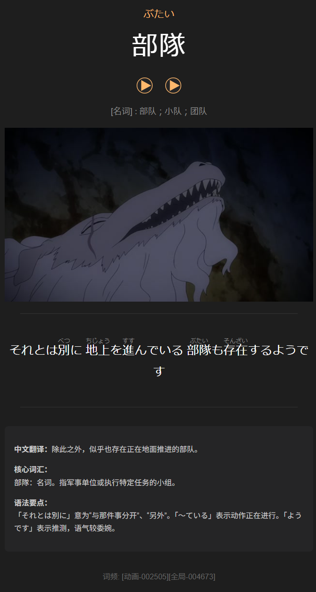
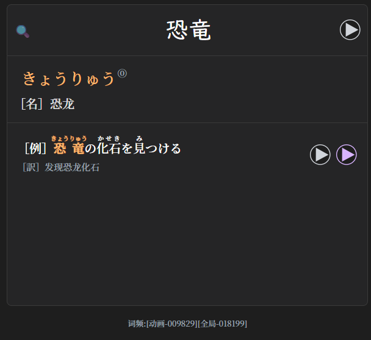
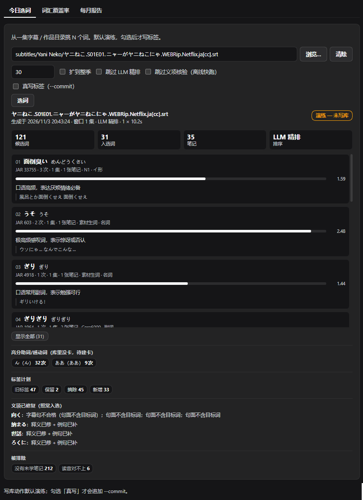
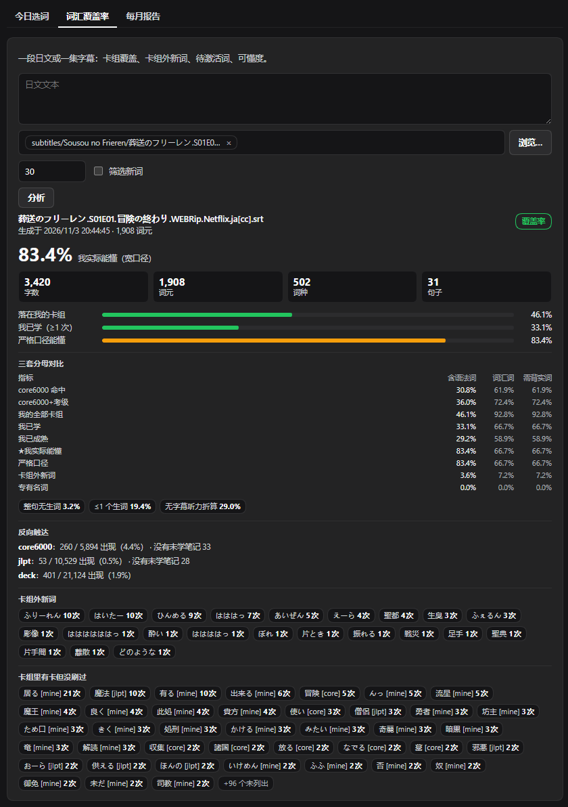
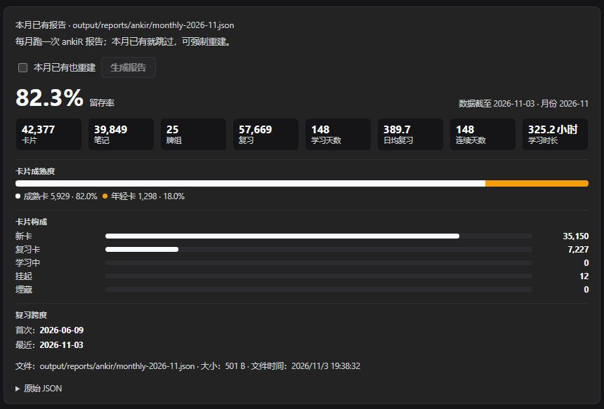

<p align="center">
  
</p>

# anki-workspace

> 状态：active ｜ 最后核实：2026-11-03

一个「日语学习 × Anki」自动化工作区：把「看动画 → 做卡 → 复习 → 查漏」串成可重跑的脚本，
而不是每次手工整理。当前收藏 **39,820 张卡 / 26 个牌组**，所有入口都在 `code/cli.py`。

## 先看效果：卡面与面板

六张都是 2026-11-03 的真实运行截图。一张图配一段说明——**图里是什么、练什么、数字从哪来**；
点图可看原尺寸。

### 三种卡，三种问法

<p align="center">
  <a href="docs/images/card-1-listening.png"></a>
</p>

**听辨卡 · `0-素材生词`：先听声音，再认词形**

正面只有词形和词性，词音频自动播放；翻面才给读音、词性释义、挖出这个词的那句台词（带振假名）、
动画画面和讲解。底部 `[动画-002505][全局-004673]` 是 Jiten 词频——挖词时先按这个排名决定收不收、
先不先学。

> `0-素材生词` 和 `1-高频日语单词 6000`（core6000）共用同一个笔记类型 `Japanese Vocabulary`
> 与同一个模板（`Word → Meaning`），卡面完全一样；区别只在词的来源：一个从看过的字幕里挖，
> 一个来自 Core 6000 词表。

<p align="center">
  <a href="docs/images/card-2-recall.png"></a>
</p>

**看字回想卡 · `2-考级词汇`：只看词形，回想读音和释义**

正面给词形和原句音频，读音与释义要自己先想；翻面才给读音、音调、词性、中文释义与例句。
底部同样是 Jiten 词频。

<p align="center">
  <a href="docs/images/card-3-sentence.png"></a>
</p>

**例句卡 · `2-例句`：整句听辨**

正片画面 + 原声提问，翻面是带振假名的整句、中文翻译、核心词汇与语法要点。画面和字幕是素材，
**讲解文字才是工作区生成的**。

### 三张面板 tab

<p align="center">
  <a href="docs/images/今日选词.png"></a>
</p>

**今日选词**：候选 121 → 入选 31 词 / 35 张笔记，LLM 精排 10.2 秒

选字幕或作品目录 → 候选 / 入选 / 笔记 KPI、词卡分数条与模型理由、标签计划、义项修复与被剔清单。
默认演练，勾「真写标签」才给 `today-new` 加 `--commit`。

<p align="center">
  <a href="docs/images/词汇覆盖率.png"></a>
</p>

**词汇覆盖率**：1,908 词元 / 502 词种，可懂度 83.4%

可懂度 headline、卡组 / 已学 / 严格三条覆盖率条、三套分母对比表、卡组外新词与待激活 chips。只读。

<p align="center">
  <a href="docs/images/每月报告.png"></a>
</p>

**每月报告**：留存率 82.3%，42,377 张卡 / 57,669 次复习 / 325.2 小时

留存率、卡片构成、成熟卡 / 年轻卡比例，原始 JSON 可折叠；只读 Anki，每月写一份
`output/reports/ankir/monthly-YYYY-MM.json`。

> 截图是 2026-11-03 的真实运行：选词是 `ヤニねこ` 第 1 集，覆盖率是 `葬送のフリーレン` 第 1 集。

## 从这里开始

| 你想… | 从哪开始 |
|---|---|
| 先看卡面、面板长什么样 | 上面「先看效果」六张图 |
| 直接拿它学日语 | §2 五分钟上手 → §3 每天怎么用 |
| 把一集新番字幕做成卡 | §4 新素材：一集字幕变卡 |
| 只想要牌组文件 | §12 整库下载 |
| 想在 Harness 面板里点着用 | §6 DSH 插件 |
| 想看输出长什么样 | [docs/reports/sample/](docs/reports/sample/README.md)（作者的真实报告样板） |
| 改脚本 / 核对某个数字怎么算 | [docs/implementation.md](docs/implementation.md) |
| 让 AI 代理替你操作 | [AGENTS.md](AGENTS.md)（行为契约） |

本文件面向**使用者**：是什么、怎么装、每天怎么用、出问题去哪看。实现方式与内部细节在
[docs/implementation.md](docs/implementation.md) 与各专项手册；Agent 的行为契约在
[AGENTS.md](AGENTS.md)。

---

## 1. 这是什么

**为「提升日语动画听力」而建**——目标是甩开字幕听懂对白，而不是应付考试。
打底是两套成熟考级牌组（`1-高频日语单词 6000`、`2-考级词汇` N5–N1）覆盖日常日语的骨架；
动画对白还有考级词表查不到的词汇面（拟声拟态、口语缩略、题材词、俚语），
于是第三个牌组 `0-素材生词`：从看过的字幕里挖「**考级牌组里没有、但 Jiten 动画词频里常见**」的词收进去——
**这是本工作区最主要的服务功能**。

| 主线 | 你给它 | 它给你 |
|---|---|---|
| 每集流水线 | 一集字幕（`.ass/.srt`） | 例句卡 → 清理 → 讲解 + 振假名 → 素材生词 → 配音 |
| 每日链路 | 当天字幕（自动选 30 个词） | tag `今天学习生词`、日语讲义、复习后的弱项报告 |
| 词汇分析 | 字幕语料 + 现有卡组 | 覆盖率、新词表、挖掘窗口建议、跨作品通用性判定 |
| 收集类 | 一段文字 / 一集字幕 | 专有名词卡（`3-专有词汇`，不进队列）、`复习::<名称>` 标签 |

它会替你做机械活，但**不替你做学习决策**，也不碰你的复习进度：

| 它会 | 它不会 |
|---|---|
| 清理无学习内容的卡、生成振假名与讲解、配音 | 决定你学哪些词、什么时候停学 |
| 按词频挑出今天该学的 30 个词 | 改 `due/ivl/factor/type` 等调度列、牌组选项、笔记模板 |
| 挖字幕生词、出覆盖率与弱项报告、一键备份 | 覆盖你已有的讲解（默认演练，`--commit` 才写） |

### 三个牌组，三种卡

三个牌组问的不是同一件事：素材生词练**听辨**（词音频先响，认词形与意思），考级词汇练**看字回想**
（只看词形，回想读音和释义），`2-例句` 练**整句**（画面 + 原声 → 句子和讲解）。三张卡面（翻面后的
答案面）与逐张说明见开头「先看效果」；`0-素材生词` 与 core6000（`1-高频日语单词 6000`）共用同一个
笔记类型与模板，卡面完全一样，区别只在词的来源——一个从看过的字幕里挖，一个来自 Core 6000 词表。

---

## 2. 五分钟上手

需要三样东西：**Anki + AnkiConnect**（代码 `2055492159`，用的时候保持 Anki 打开）、
**Python 3**（建议 3.10+，第三方库放工作区 `data/pylibs/`，不污染系统环境）、
以及可选的**本地模型**（OpenAI 兼容端点；不跑模型时，体检 / 覆盖率 / 弱项等只读命令照常可用）。

```powershell
$WS = "<工作区根>"      # 换成这个目录的绝对路径
$PY = "python"          # 换成你的 Python 3

& $PY "$WS\code\cli.py" doctor          # ① 体检：0=全绿 2=只有提示 1=有阻塞，先修再动手
& $PY "$WS\code\cli.py" list            # ② 看有哪些入口（永远比文档新）
& $PY "$WS\code\cli.py" <组> --help     # ③ 查具体参数
```

`doctor` 一次跑完九项体检，各项口径见 [architecture §3](docs/architecture.md)。

**没有现成收藏？** 先导入 §12 的三个 `.apkg`。**已有自己的库？** 直接导入同一套牌组即可；
工作区按牌组名、笔记类型和字段名取数据，结构不同的库需要先改 `code/common/jp_decks.py` 里的常量。
缺依赖时 `doctor` 会提示。唯一的例外：跑**备份**前要**完全退出** Anki（见 §9）。

---

## 3. 每天怎么用

| 时间 | 做什么 | 命令 |
|---|---|---|
| 早上 | 选今天学的 30 个词 | `cli.py today-new "subtitles\<作品>" --commit` |
| 早上 | 生成讲义 | `cli.py daily stats` → `plan` → `check` → `gen` |
| 白天 | 打开 Anki 学 | — |
| 晚上 | 看今天答得不好的词 | `cli.py weak today --days 3 --plain` |
| 周末 | 出库层面分析 | `cli.py r report`（只读，需本机装 R 与 ankiR） |

- **选词**：扫整部作品打分，挑 30 个**已有卡、还没学**的词打上 tag `今天学习生词`；每次运行
  全量替换旧标签，只写标签不碰调度列。默认演练，`--commit` 才真写，`--revert --commit` 撤销。
  打分公式与闸门见 [implementation §3](docs/implementation.md)。
- **义项修复**：选词时义项核验对不上的词默认先修原卡再回插（补真实例句 + 按字幕义项重写
  `Meaning`，重判通过才算修好；写卡只走 writeback，同样受 `--commit` 管）。事后补跑
  `cli.py sense-repair plan` / `apply --commit`（写前自动备份，可 revert）；`--no-sense-repair`
  退回「只剔不修」。
- **讲义**：`daily` 四步链只读 Anki、不写库，做坏了删文件重跑；产物是 `output/daily/lesson_latest.md`。
  没有 tag 就什么都不生成，细则见 [today_new-使用说明](docs/today_new-使用说明.md)。
- **弱项**：`weak` 另有 `revlog` / `pace` / `build-list` 子命令；默认读实时数据，
  `--source snapshot` 可离线跑。
- **库层面**：`r summary` / `r due` / `r report` 只读，数据默认取 live 收藏。
- **不想敲命令**：同样的选词 / 覆盖率 / 报告在 DSH 面板里点着也能跑，见 §6。

---

## 4. 新素材：一集字幕变卡

以 asbplayer 导入 Anki、挂 `待标记` 标签的例句卡为起点：

```powershell
# ① 清理：判掉没有学习内容的卡；只想筛字幕可先跑 filter_subtitle
& $PY "$WS\code\cli.py" pipeline prepare
& $PY "$WS\code\cli.py" pipeline triage --query "tag:待标记"

# ② 阶段 2–5 一条命令：默认演练，看过输出再加 --commit
& $PY "$WS\code\cli.py" episode --tag "动画::<作品>::<季>::第NN集" --input-tag 待标记 --commit
```

生成讲解与振假名、挖素材生词、配音、换正式集标签，一条命令串完；只跑某几步用 `--phases`。
每步的判据、断点续跑与失败重试见 [pipeline-guide](docs/pipeline-guide.md)（按节查即可）。

**换新作品**：字幕目录命名约定见 [subtitles/README.md](subtitles/README.md)；集标签写法历史上有
好几种，拼查询串前先看库里现有标签。

---

## 5. 量一量：我认识多少、还差哪些词

输入任意字幕（`.srt/.ass/.vtt`）、文字或一段话，就能回答「这段文字我懂多少」：

```powershell
& $PY "$WS\code\cli.py" vocab cover "subtitles\Yani Neko\…\.srt"   # 覆盖率
& $PY "$WS\code\cli.py" vocab report "subtitles\Yani Neko"          # 学习用生词报告
```

词汇状态来自 AnkiConnect 现场快照，换素材不用动卡组。报告口径（三个分母、「已学 / 已成熟」定义、
名次算法）见 [implementation §4](docs/implementation.md)。

---

## 6. 在 DSH 里点着用：Anki 工作区插件

> 源码与实现细节：[`code/plugins/anki-workspace/`](code/plugins/anki-workspace/README.md)（装进 DSH 后叫
> `@local/anki-workspace`）。本节只讲它是什么、能干什么、怎么装怎么退。

`@local/anki-workspace` 把工作区的六项常用能力接进 **DeepSeek Harness（DSH）的 Web 控制台**——
就是现在看这份文档的这个界面：**六个 Agent 工具 + 一段每轮注入的上下文 + 一个侧边栏面板**。
它自己**不直接读写 Anki**，每次动作都落回 `code/cli.py` 与 `code/common/anki_api.py`，所以
`--commit`、写前备份、写后回读这些闸门一条不少；面板上每个写库动作也都有「真写」勾选框，默认演练。

| 能力 | 面板 / 工具 | 写库 |
|---|---|---|
| 增加例句 | tab「增加例句」：点名 core6000 词，走 `core6000 gen → tts → apply` | 默认演练；勾「真写」才给 `apply` 加 `--commit` |
| 今日选词 | tab「今日选词」：选字幕或作品目录 → 候选/入选/笔记 KPI、词卡分数条与模型理由、标签计划、义项修复与被剔清单 | 默认演练；勾「真写标签」才 `--commit` |
| 词汇覆盖率 | tab「词汇覆盖率」：可懂度 headline、卡组/已学/严格三条覆盖率条、三套分母对比表、卡组外新词与待激活 chips | 只读 |
| 每月报告 | tab「每月报告」：留存率、卡片构成、成熟卡/年轻卡比例，原始 JSON 可折叠 | 只读 Anki；每月写一份 `output/reports/ankir/monthly-YYYY-MM.json` |
| 在线状态 / 体检 | 右上角两枚小状态点（绿/黄/红），点开是详情与「立即检测 / 跑 doctor」 | 只读 |

六个工具是 `anki_status`、`anki_doctor`、`anki_add_example`、`anki_today_new`、`anki_vocab_cover`、
`anki_study_report`；面板和工具**共用同一份实现**（`lib/core.js`），所以「点按钮」和「让代理跑」
结果一致，工具返回值也直接喂回对话。

三张 tab 的截图与逐张说明在开头「先看效果」；每个 tab 做什么、写不写库见上表，装法与回退见本节末尾。

### 上下文注入：代理怎么知道 Anki 开着

- 每轮系统提示里注入一段 `<anki-workspace>`：工作区根、AnkiConnect 版本与牌组数、`doctor` 结论
  （通过 / 提示 / 阻塞计数）、检测时间——代理一开口就知道该不该先修体检。
- 后台每 10 分钟刷新一次（`refreshMinutes`）；工具调用会顺带更新缓存，刚跑过 `anki_status` /
  `anki_doctor`，下一轮上下文里就是最新结果。

### 装在哪、怎么改、怎么退

| 配置（`cordis.patch.yml`） | 默认 | 说明 |
|---|---|---|
| `workspaceRoot` | 本机 anki-workspace 绝对路径 | 上下文注入没有 Agent 作用域，必须显式写明 |
| `pythonPath` | `python` | 调 `cli.py` 用的解释器 |
| `timeZone` | `Asia/Shanghai` | 判断「本月」用 |
| `refreshMinutes` | `10` | 后台状态刷新间隔 |

- **安装**：`plugin_manager install_bundle` → `target: <工作区>\code\plugins\anki-workspace`。
  本机已装：`~/.dsh/profiles/desktop/node_modules/@local/anki-workspace` 是指向源码目录的符号链接。
- **回退**：`plugin_manager remove_bundle` → `target: @local/anki-workspace`。只移除插件，
  `output/` 里已生成的报告与缓存不删；写库动作的回退仍由脚本自己的备份负责（见 §9 备份与恢复）。
- **改代码**：动 `index.js` / `lib/core.js` / `client.js` 要 `remove_bundle` → `install_bundle`
  或重启 Harness 才生效（单纯关/开插件不会重新 import 已缓存的 Host 模块）；只改配置关/开一次即可。
- **面板接口**：`POST /anki-workspace/api`，只接受 loopback 同源请求与 JSON Content-Type；
  另有 `browse`（文件/目录选择器，范围限 `workspaceRoot` 内）与 `report`（读当月报告 JSON）两个只读方法。

已知限制：选择器只在工作区子树里浏览（要选工作区外的字幕，先拷进 `subtitles/`）；`workspaceRoot` 是
绝对路径，换工作区要改配置；增加例句依赖本机模型端点与 jisho；面板视觉未做浏览器自动化验证。

---

## 7. 常用命令速查

| 场景 | 命令 |
|---|---|
| 开工门禁 / 看入口 / 查参数 | `cli.py doctor`（退出码 1 先修）· `cli.py list` · `cli.py <组> --help` |
| 今日选词 / 讲义 | `cli.py today-new "<字幕目录或文件>" [--commit]` · `cli.py daily stats/plan/check/gen` |
| 弱项 / 库分析（只读） | `cli.py weak today --days 3 --plain` · `cli.py r summary/due/report` |
| 覆盖率与生词报告 | `cli.py vocab cover/newwords/report/mine_window` |
| 每集流水线 | `cli.py pipeline prepare/triage` · `cli.py episode --tag … --input-tag 待标记 [--commit]` |
| 单卡讲解 / 激活 / 挖词 / 配音 | `cli.py cards` · `activate` · `mine` · `audio`（均默认演练） |
| core6000 补例句 / 找例句 | `cli.py core6000 gen --words "…"` · `cli.py jisho --word <词>` |
| 讲解加强 / ImmersionKit / 专名 | `cli.py ainote enrich` · `cli.py immersion` · `cli.py proper` |
| 字幕生词打标 / 回填 Jiten 词频 | `python code\tools\subtitle_tag.py <字幕> --name <名称> --commit` · `python code\analysis\vocab_cover\freq_external.py field --tag "需更新JAR" --remove-tag` |
| 按 Jiten 名次重排新卡顺序 | Anki 插件 `jiten_reorder`，见 [docs](docs/jiten-reorder-使用说明.md)（只改新卡 `due`） |
| 备份 / 清临时文件 | `cli.py backup --dest <路径>`（先退出 Anki）· `cli.py temp list` → `temp clean` |

写库类命令一律默认演练，`--commit` 才真写；参数用 `cli.py <组> --help` 现查。未纳入统一入口的脚本
（如 `vocab_cover/` 里的数据链零件）直接调用，见 [architecture §2](docs/architecture.md)。

---

## 8. 目录结构

```
anki-workspace/
├─ README.md                本文件：给使用者的说明书
├─ AGENTS.md                ★ Agent 行为契约（边界 / 禁令 / 验证 / 求助）
├─ code/                    可复用代码：cli.py（统一入口）+ common / execution / tools / analysis / tests
│                             （plugins/ 是 DSH 插件；execution 下两个系列各自一个文件夹：core6000/、lesson/）
├─ docs/                    手册与档案（implementation / architecture / pipeline-guide / decisions …）
├─ data/                    输入与中间产物（snapshots、pipeline、vocab、pylibs、freq、dict）
├─ output/                  生成物（daily 讲义、audio）
├─ subtitles/               原始字幕素材
├─ temp/                    ★ 唯一的一次性文件区
└─ .dsh/skills/             技能（任务 → 技能路由表在 AGENTS.md §4）
```

每个脚本的职责见 [AGENTS.md §5](AGENTS.md) 和 [architecture §1](docs/architecture.md)。

---

## 9. 备份与恢复

```powershell
& $PY "$WS\code\cli.py" backup --dest <备份盘>:\anki-backup-<日期>
```

硬规则：备份前**完全退出 Anki**；新备份校验通过后才删旧的。备份含工作区、收藏库、媒体与插件，
校验与恢复流程见 [docs/backup-sop.md](docs/backup-sop.md)（唯一权威版）。
为什么必须备份：git 只跟踪源码与文档，**卡片数据没有 git 可退**，唯一退路是备份。

---

## 10. 测试

回归测试全是**独立脚本、纯离线**，秒级返回：`& $PY "$WS\code\tests\test_llm_out.py"`
（换一个文件名就是另一组）。改过 `code/common/` 或 `code/execution/` 就把 `code\tests\*.py`
全跑一遍；只改文档不用跑。每个测试挡什么见 [implementation §5](docs/implementation.md)。

---

## 11. 常见问题

| 现象 | 原因 / 怎么办 |
|---|---|
| `doctor` 报 AnkiConnect 连不上 | Anki 没开、AnkiConnect 没装，或 8765 被占用；备份时反过来要退出 Anki |
| 命令跑完什么也没变 | 多数写库命令**默认演练**，确认输出无误后再加 `--commit` |
| 日文乱码 / 字段判断恒真 | 不要用 PowerShell 解析日文文本；数据异常用 Python 脚本查 |
| 分析数字和 Anki 里对不上 | 离线分析可能读的是旧快照；以 live 收藏为准 |
| 我的复习进度会被覆盖吗 | 不会。脚本不写调度列，导出的 `.apkg` 也不带复习历史 |
| 本地模型 401/403 | key 查找顺序：`--api-key` → `$env:DSH_LOCAL_LLM_API_KEY` → `~/.dsh/local-llm.json`；别把 key 写进代码或文档 |
| 改坏了怎么退 | 代码 / 文档用 `git diff`；卡片数据用备份（§9）或写库脚本留下的 `backup_*.json` |

更多排障见 [docs/troubleshooting/](docs/troubleshooting/README.md) 与
[docs/architecture.md §6](docs/architecture.md)。专项手册与各文档索引在
[docs/implementation.md](docs/implementation.md) 与 [AGENTS.md](AGENTS.md) 里按主题定位。

---

## 12. 整库下载

完整收藏打包成 `.apkg` 放在 Release 里——**`.apkg` 不进 git 历史**（单个 1.6 GB，远超仓库的文件上限）：

**[deck-2026-10-29](https://github.com/fredgeoO/anki-workspace/releases/tag/deck-2026-10-29)**

三个 `.apkg` 分别对应 `0-词汇`（25,921 卡 / 1.60 GiB）、`1-语法`（3,160 / 0.21 GiB）、
`2-例句`（10,739 / 0.92 GiB），各导一次即可；牌组名带完整路径，导入后自动挂回 `0-日本语学习` 下。
Release 单个附件上限 2 GiB，所以按三个子牌组拆包。

**不含复习历史**（导出时 `includeSched=false`）：调度列全部清零、所有卡按新卡
导入，既不覆盖你自己的进度，也不暴露作者的学习记录；音频随包导入媒体库。

改过卡要重新打一份：Anki 开着，用 AnkiConnect `exportPackage` 按三个子牌组拆包、
`includeSched=false`，命令见 [backup-sop §9](docs/backup-sop.md)。

---

## 13. 牌组版权与署名（第三方牌组）

- **`2-考级词汇`**：【egg rolls】JLPT N1–N5 一万词 v3.5，原作者 **egg rolls**
  （仓库 [5mdld/anki-jlpt-decks](https://github.com/5mdld/anki-jlpt-decks)），许可
  **[CC BY-NC 4.0](https://creativecommons.org/licenses/by-nc/4.0/deed.zh-hans)**。
- **`1-高频日语单词 6000`**：Japanese Core 6000 词表（公开资源），本工作区据此建卡；
  对外分发时请保留词表出处与原始许可声明。

> 字幕、动画画面等素材的版权另见 [subtitles/README.md](subtitles/README.md)；Jiten 动画词频表为
> CC BY-SA 4.0（见 [data/freq/README.md](data/freq/README.md)）。

---

## 14. 与 Agent 的边界

[AGENTS.md](AGENTS.md) 是**代理的行为契约**（角色边界、禁令、验证命令、失败处理与求助条件），
本文件是**人的项目说明书**（是什么、怎么跑、怎么测）。两者互相引用、**不互相复制**：
项目事实以本文件为准，行为约束以 AGENTS.md 为准。**若两者冲突**（例如本文件描述某操作可行、
AGENTS.md 列为禁止），以 AGENTS.md 为准，代理应**停下询问用户**，不要在文档之间自行仲裁。
技能路由表在 AGENTS.md §4，技能本体在 `.dsh/skills/`。
